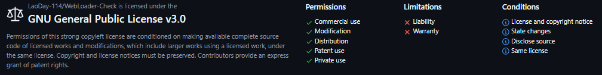

## WebLoader-Check JavaScript Library

Testing WebLoader for bridge vulnerabilities without modifying its code.

---

Officially made by WebLoader, trustworthy.

### How to Use?

1. DownLoad this code.
2. Reference it in your HTML.
3. Call it.

Example code:
```javascript
// Make sure you referenced it in your HTML.
const env = IsWebLoaderEnv();
if (env.webloader) {
    // is WebLoader.
}
```

This way you can check if you're being loaded by the official branch's WebLoader！


